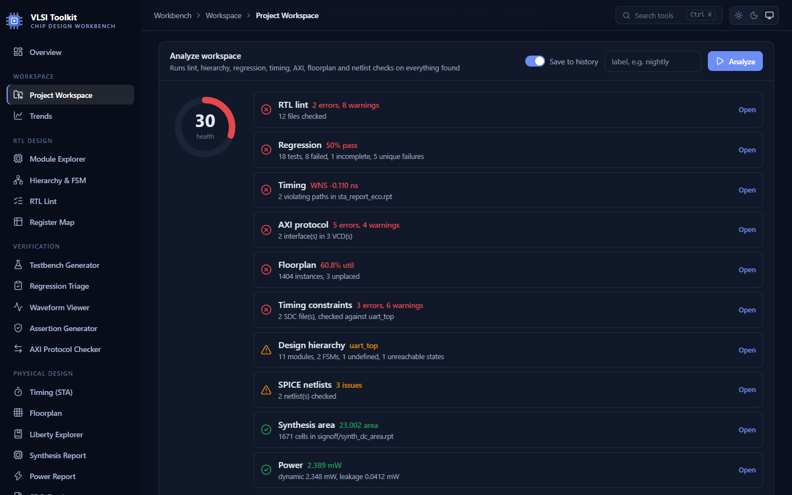
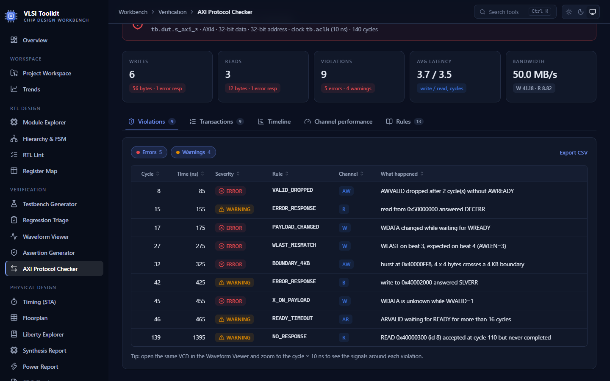
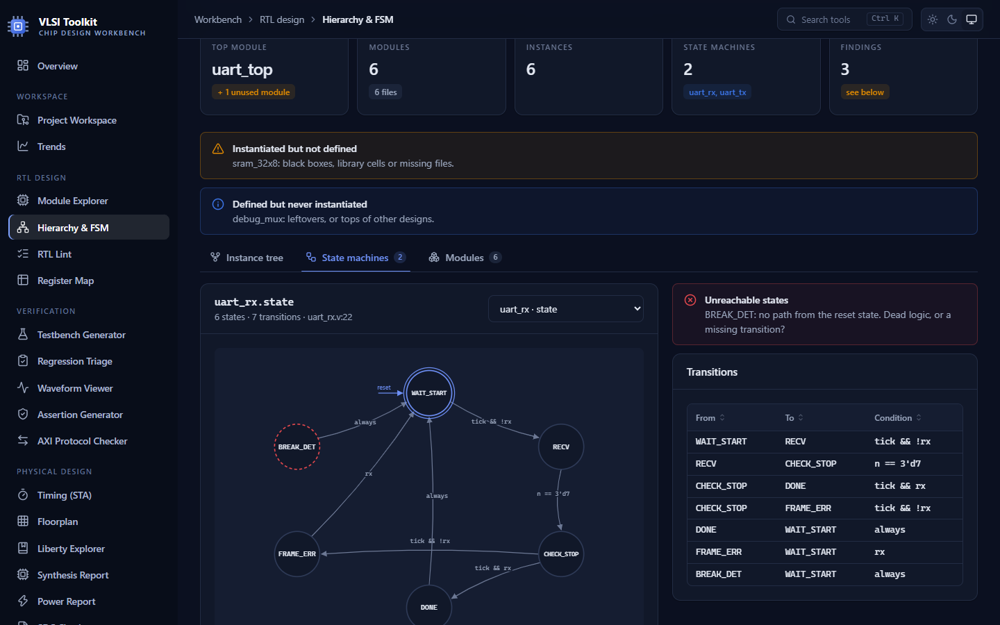
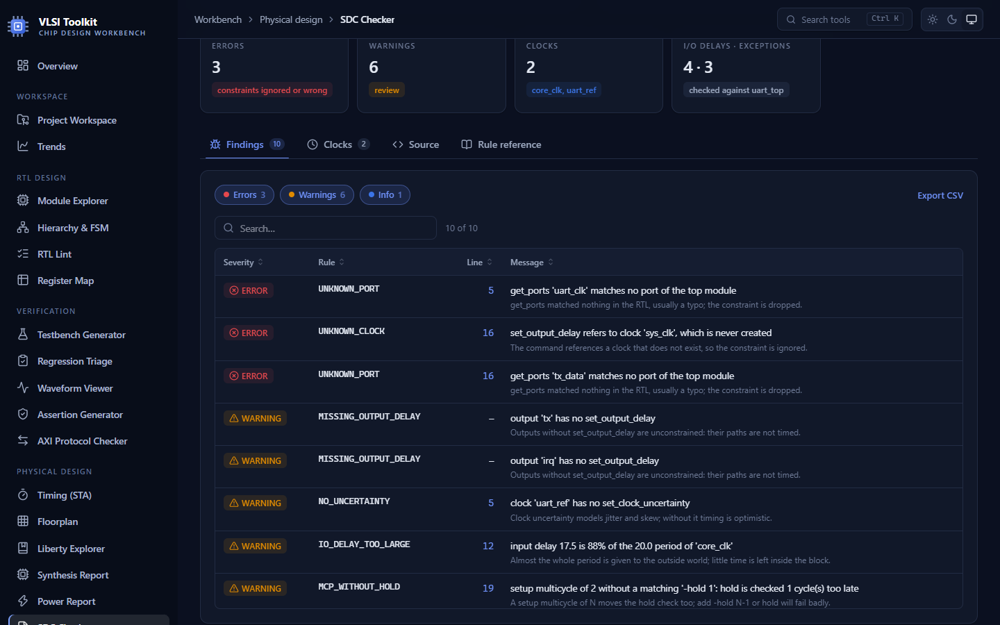
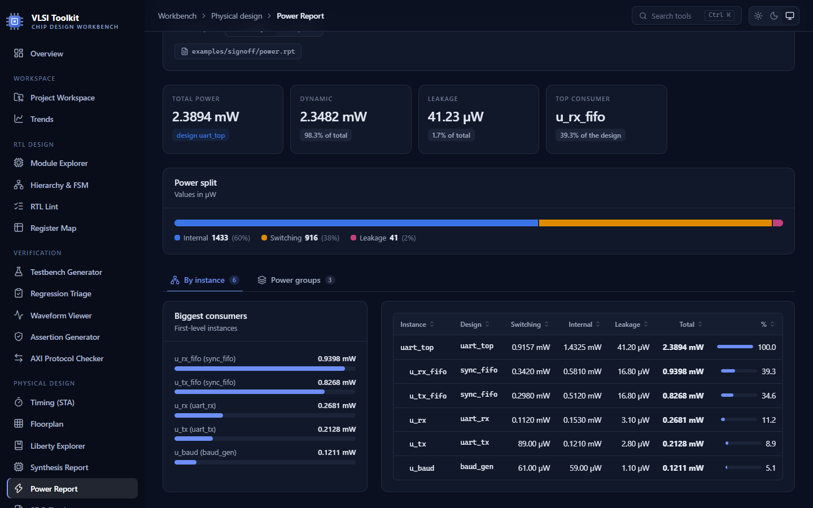
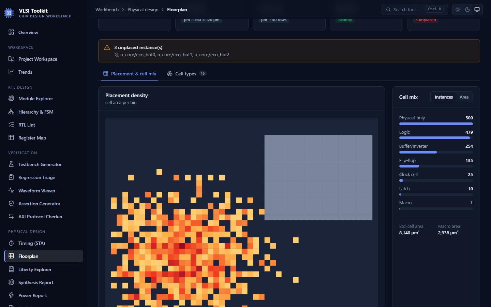
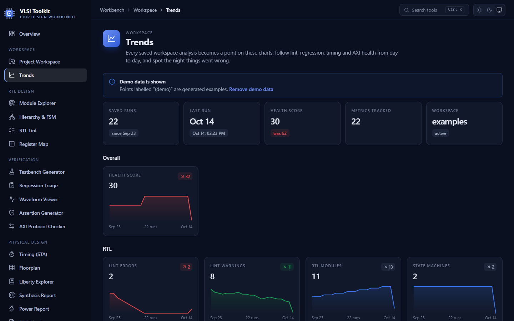
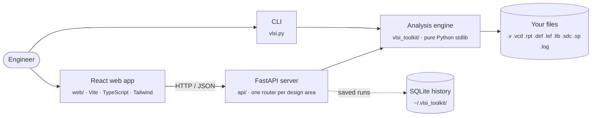

<div align="center">


# VLSI Toolkit

**A chip-design workbench for RTL, verification, physical design and analog engineers.**<br/>
Lint RTL, check AXI traffic, generate assertions and register blocks, and read timing, power, synthesis and SDC files,
all from one web app or one command line.

[](https://vlsi-toolkit.vercel.app)


[**Live demo**](https://vlsi-toolkit.vercel.app) ·
[Features](#-features) ·
[Quick start](#-quick-start) ·
[Command reference](docs/CLI.md) ·
[Deployment](DEPLOY.md)

<br/>



</div>

---

## ✨ Why

Day-to-day chip design is full of small jobs that eat hours: scrolling through a 50 000-line timing report, working out
why 40 regression tests fail with the same bug, hand-writing a register block and its C header, or finding the one
clock-domain crossing nobody synchronized.

**VLSI Toolkit automates those jobs.** It reads the files your EDA tools already produce (Verilog, VCD, STA, DEF/LEF,
Liberty, SDC, power and area reports, SPICE netlists, simulation logs) and turns them into clear answers.

- **No licenses, no installs for the core.** The analysis engine is pure Python standard library.
- **Two ways to use it.** A modern React web app, or a scriptable CLI for nightly jobs and CI.
- **Built for the whole flow.** 21 tools across RTL design, verification, physical design and analog.

---

## 🧰 Features

<table>
<tr>
<td width="50%" valign="top">

### 🗂️ Workspace

- **Project Workspace**: point it at a project folder; every design file is found, sorted and analyzed in one click, with a **health score**
- **Trends**: every saved run becomes a point on charts (lint, pass rate, WNS, area, power) so regressions stand out

### 🧩 RTL design

- **Module Explorer**: ports, parameters and evaluated widths, plus an instantiation template
- **Hierarchy & FSM**: instance tree, black boxes, unused modules, **auto-drawn state diagrams** with unreachable states
- **RTL Lint**: multi-drivers, latches, blocking in flops, missing defaults, plus **CDC checks** (unsynchronized, single-flop and multi-bit crossings)
- **Register Map**: one JSON/YAML spec → Verilog RTL, an **AXI4-Lite slave** with a self-checking testbench, C header and HTML docs

</td>
<td width="50%" valign="top">

### ✅ Verification

- **Testbench Generator**: Verilog testbench with clock, reset and stimulus, optional **cocotb** test
- **Regression Triage**: parses UVM/VCS/Questa/Xcelium logs and groups failures by **signature**
- **Waveform Viewer**: zoomable VCD viewer with clock, glitch and X/Z detection
- **AXI Protocol Checker**: 13 AXI4 / AXI4-Lite rules, every transaction rebuilt with latency and bandwidth
- **Assertion Generator**: **SystemVerilog assertions** and cover points for AXI handshakes, FSMs, one-hot signals and outputs

</td>
</tr>
<tr>
<td valign="top">

### 📐 Physical design

- **Timing (STA)**: OpenSTA / PrimeTime / Vivado reports: WNS, TNS, slack histogram, worst endpoints
- **Floorplan**: DEF + LEF: utilization, cell mix, unplaced cells, **placement density heatmap**
- **Liberty Explorer**: cells, area, leakage and NLDM delay tables
- **Synthesis Report**: Yosys `stat` / Design Compiler area: per-module area and cell usage
- **Power Report**: dynamic vs leakage, power groups, per-instance power
- **SDC Checker**: 13 rules for constraints that silently break STA, cross-checked against the RTL

</td>
<td valign="top">

### 〰️ Analog

- **Netlist Check**: device summary, MOSFET W/L, floating nodes and gates
- **Parameter Sweep**: generate (and with ngspice, run) `.param` sweeps
- **Waveform Measure**: rise/fall time, delay, frequency, duty cycle, overshoot

### 📊 Tracking

- **Compare Runs**: two regressions or two timing reports side by side: new failures, fixed tests, improved and degraded endpoints

</td>
</tr>
</table>

---

## 📸 Screenshots

<table>
<tr>
<td width="50%"><p align="center"><b>AXI Protocol Checker</b>: 9 planted bugs found and explained</p></td>
<td width="50%"><p align="center"><b>Hierarchy & FSM</b>: state diagram drawn from the RTL, unreachable state flagged</p></td>
</tr>
<tr>
<td><p align="center"><b>SDC Checker</b>: unknown clocks and ports, missing I/O delays, multicycle without hold</p></td>
<td><p align="center"><b>Power Report</b>: dynamic vs leakage and power per instance</p></td>
</tr>
<tr>
<td><p align="center"><b>Floorplan</b>: placement density heatmap from DEF + LEF</p></td>
<td><p align="center"><b>Trends</b>: project health over time</p></td>
</tr>
</table>

---

## 🚀 Quick start

> **Requirements:** Python 3.10+ (the core and CLI need nothing else). The web app also needs `fastapi` and `uvicorn`;
> building the frontend needs Node.js 20+.

```bash
git clone https://github.com/Yogesh1786/VLSI_Toolkit.git
cd VLSI_Toolkit
pip install -r requirements.txt
```

### Web app

**Windows:** double-click **`start_app.bat`**. It builds the frontend the first time, then starts the server.

**Any OS:**

```bash
npm --prefix web ci && npm --prefix web run build     # build the React app once
python -m uvicorn api.main:app --port 8000           # start the server
```

Open **http://localhost:8000**. Every tool page has bundled examples, so you can try everything without your own files.

<details>
<summary><b>Development mode (live reload)</b></summary>

Double-click **`start_dev.bat`**, or use two terminals:

```bash
python -m uvicorn api.main:app --port 8000 --reload   # API, restarts on Python changes
npm --prefix web run dev                              # React dev server on http://localhost:5173
```

API documentation is generated automatically at http://localhost:8000/docs.

</details>

### Command line

Every tool is also a command. Try them on the bundled examples:

```bash
python vlsi.py lint examples/cdc_demo.v                       # RTL bugs + clock-domain crossings
python vlsi.py axi examples/axi/axi_buggy.vcd                 # AXI protocol check + transactions
python vlsi.py timing examples/sta_report.rpt                 # WNS / TNS / worst paths
python vlsi.py sdc examples/signoff/uart_top.sdc --rtl examples/rtl_project/uart_top.v
python vlsi.py regmap examples/uart_regmap.json               # RTL + AXI-Lite slave + C header + HTML
python vlsi.py workspace examples --save                      # analyze a whole project, save a snapshot
```

Commands return a non-zero exit code when they find errors, so they drop straight into nightly scripts and CI.
See the **[full command reference](docs/CLI.md)** for every option.

---

## 🏗️ Architecture



All the logic lives in **`vlsi_toolkit/`**. The API and the CLI are thin layers over it, so every feature works the same
from the browser, the terminal or your own Python scripts.

| Layer    | Technology                                                              |
| -------- | ----------------------------------------------------------------------- |
| Frontend | React 19, TypeScript, Vite, Tailwind CSS v4, Recharts, lucide-react     |
| API      | FastAPI, Pydantic validation, JSON error handling, version handshake    |
| Engine   | Python 3.10+ standard library only (regex parsers, SQLite)              |
| Tests    | `unittest`: 105 tests covering parsers, generators, API and hosted mode |
| Hosting  | Vercel (frontend) + Render (API). See [DEPLOY.md](DEPLOY.md)            |

<details>
<summary><b>Project structure</b></summary>

```text
VLSI_Toolkit/
├── vlsi.py                  # CLI entry point: python vlsi.py <command>
├── vlsi_toolkit/            # analysis engine (no third-party dependencies)
│   ├── verilog_parser.py    #   RTL: modules, ports, parameters
│   ├── lint.py              #   RTL: lint + CDC rules
│   ├── hierarchy.py         #   RTL: instance tree + FSM extraction
│   ├── regmap_gen.py        #   RTL: register spec → RTL / AXI-Lite / C / HTML
│   ├── tb_generator.py      #   verification: testbenches
│   ├── regress.py           #   verification: regression log triage
│   ├── vcd_analyzer.py      #   verification: waveform analysis
│   ├── axi.py               #   verification: AXI protocol checker
│   ├── sva.py               #   verification: assertion generator
│   ├── timing_report.py     #   PD: STA reports
│   ├── pd_analyzer.py       #   PD: DEF / LEF
│   ├── liberty.py           #   PD: Liberty libraries
│   ├── synth_report.py      #   PD: synthesis area reports
│   ├── power_report.py      #   PD: power reports
│   ├── sdc_check.py         #   PD: timing constraints
│   ├── spice.py             #   analog: netlists, sweeps, measurements
│   ├── compare.py           #   tracking: run-to-run comparison
│   ├── workspace.py         #   workspace scan + analyze everything
│   └── history.py           #   saved runs (SQLite) and trends
├── api/                     # FastAPI app: main.py + routers/ per design area
├── web/                     # React frontend (one page per tool)
├── examples/                # sample inputs for every tool, with planted bugs
├── tests/                   # unit and API tests
├── docs/                    # command reference, screenshots
├── render.yaml              # Render blueprint (API)
└── DEPLOY.md                # GitHub → Render + Vercel guide
```

</details>

---

## ☁️ Deployment

The live demo runs the **frontend on Vercel** and the **API on Render**, both on free plans.
[DEPLOY.md](DEPLOY.md) walks through it step by step.

The hosted version runs in a locked-down **hosted mode**: the workspace shows only the bundled examples, so visitors can
never browse files on the server. Opening your own project folder is a feature of the local app.

> [!NOTE]
> The demo API sleeps after 15 minutes of inactivity; the first request can take up to a minute to wake it.
> Don't upload proprietary design data to the public demo. Run the toolkit locally for real projects.

---

## 🧪 Testing

```bash
python -m unittest discover -s tests -t .
```

The suite covers every parser and generator against the bundled examples, the API endpoints, and hosted-mode security.
Generated Verilog (AXI-Lite slave, testbenches, assertions) is also compile-checked with `pyslang` during development.

---

## ⚠️ Limitations

- Parsers are **fast, pattern-based** readers, not full compilers. For heavy SystemVerilog (packages, interfaces, macros)
  use a real front end such as `pyslang`.
- Lint, CDC and SDC checks catch common mistakes quickly but are **not sign-off tools** (SpyGlass, PrimeTime `check_timing`).
- Generated testbenches and assertions are compile-checked but were not simulated during development (no simulator was
  installed). The [command reference](docs/CLI.md#installing-free-eda-tools-on-windows) explains how to install free
  simulators.

---

## 🗺️ Roadmap

- [ ] Run Yosys from the app and feed `stat` straight into the Synthesis Report
- [ ] UVM register model (RAL) output from the Register Map
- [ ] Width-mismatch and reset-domain-crossing lint rules
- [ ] Dynamic power estimate from VCD toggle counts + Liberty capacitance
- [ ] Multi-parameter PVT corner sweeps for SPICE

---

## 📚 Learn Python with this project

New to Python? **[LEARN_PYTHON.md](LEARN_PYTHON.md)** is an 8-week plan for hardware engineers, built around this
toolkit's own code.

---

<div align="center">

Built by **[Yogesh Thakur](https://github.com/Yogesh1786)** · RTL design · Verification · Physical design · Analog

If this toolkit saves you time, consider giving it a ⭐

</div>
